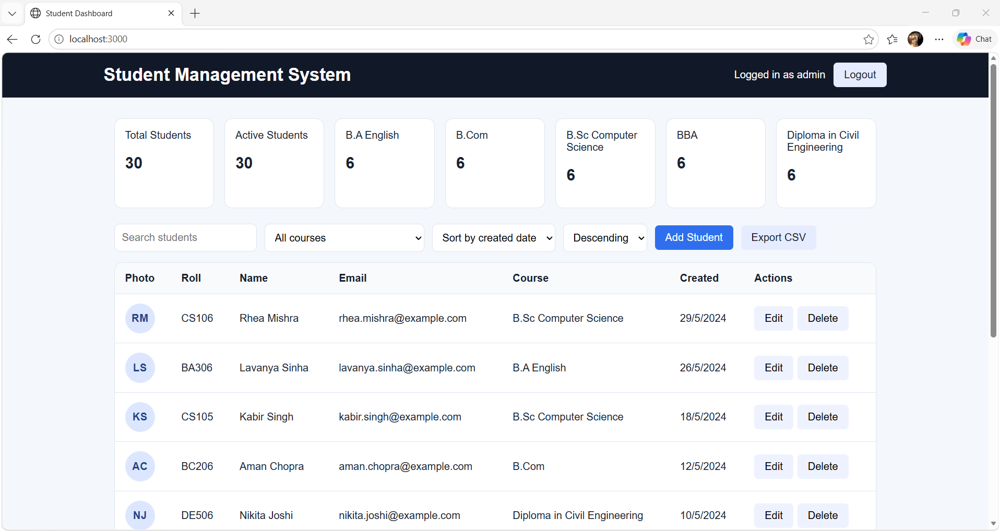

# Student Management System

A simple student management API and dashboard built with Node.js, Express, and plain HTML/CSS/JS. The app is intentionally designed for a demo environment where student reads are public, while admin actions require authentication.

## Why this project
This project demonstrates a complete backend workflow for a real-world CRUD system: request validation, database access, soft deletes, admin login, and a simple dashboard UI. The code is intentionally readable and explicit so it is easy to explain in interviews and refactor later.

## Features
- CRUD for students with soft delete and restore
- Search, filter, sort, and pagination for list queries
- Course summary stats and recent student list
- Admin login via JWT cookie authentication
- Public student reads by design for demo usage
- CSV export for admin users
- Upload support for student photos with validation
- Plain HTML/CSS/JS frontend served by Express

## Stack
- Node.js 24.17.0 (the version verified for this project)
- Express
- MySQL 8 / mysql2
- JWT + bcrypt
- Helmet + morgan + rate limiting
- plain HTML/CSS/JS

## Setup
The app expects a running MySQL server. For an ordinary local MySQL installation, use port **3306** in `.env`.

Set `DB_HOST=127.0.0.1`, `DB_PORT=3306`, `DB_USER`, `DB_PASSWORD`, and `DB_NAME` to match your local MySQL account. In development, an empty `DB_PASSWORD` is allowed when your local account has no password. Production requires a non-empty database password.

### Windows PowerShell

1. Copy the example configuration and edit it with your local MySQL credentials and a long random JWT secret:
   ```powershell
   Copy-Item .env.example .env
   notepad .env
   ```
2. Install dependencies, create/seed the database, create an admin, and start the app:
   ```powershell
   npm ci
   npm run db:setup
   npm run create-admin
   npm start
   ```

The app is available at `http://localhost:3000` unless `PORT` is changed. The `db:setup` command creates the configured database, tables, and seed data; MySQL must be running and the configured account must have permission to create the database.

### macOS / Linux (bash)

1. Copy the example configuration and edit it with your local MySQL credentials and a long random JWT secret:
   ```bash
   cp .env.example .env
   ```
   Edit `.env` in your preferred text editor.
2. Install dependencies, create/seed the database, create an admin, and start the app:
   ```bash
   npm ci
   npm run db:setup
   npm run create-admin
   npm start
   ```

## Environment variables
- PORT
- DB_HOST
- DB_PORT
- DB_USER
- DB_PASSWORD
- DB_NAME
- DB_SSL
- DB_CA_CERT
- JWT_SECRET
- COOKIE_SECURE
- NODE_ENV

## API overview
| Method | Route | Description |
|---|---|---|
| GET | /api/health | Checks database connectivity |
| GET | /api/courses | Lists all courses |
| GET | /api/stats | Returns totals, per-course counts, and recent students |
| GET | /api/students | Search, filter, sort, and paginate students |
| GET | /api/students/:id | Get one student |
| POST | /api/students | Create a student (admin only) |
| POST | /api/students/:id/photo | Upload a student photo (admin only, JPEG/PNG/WebP, max 2MB) |
| PUT | /api/students/:id | Update a student (admin only) |
| DELETE | /api/students/:id | Soft delete a student (admin only) |
| POST | /api/students/:id/restore | Restore a soft-deleted student (admin only) |
| GET | /api/students/export.csv | Download a CSV export (admin only) |
| POST | /api/auth/login | Admin login |
| POST | /api/auth/logout | Admin logout |
| GET | /api/auth/me | Current authenticated admin |

## Folder structure
```text
student-management-system/
├── public/
│   ├── app.js
│   ├── index.html
│   ├── login.html
│   ├── login.js
│   └── style.css
├── scripts/
│   ├── createAdmin.js
│   └── setupDb.js
├── sql/
│   ├── schema.sql
│   └── seed.sql
├── src/
│   ├── config/
│   │   ├── db.js
│   │   └── env.js
│   ├── controllers/
│   │   ├── authController.js
│   │   ├── courseController.js
│   │   └── studentController.js
│   ├── middleware/
│   │   ├── auth.js
│   │   ├── errorHandler.js
│   │   ├── upload.js
│   │   └── validate.js
│   ├── routes/
│   │   ├── authRoutes.js
│   │   ├── courseRoutes.js
│   │   └── studentRoutes.js
│   ├── app.js
│   └── server.js
├── tests/
│   ├── api.real.test.js
│   └── basic.test.js
├── uploads/
│   └── .gitkeep
├── .env.example
├── .gitignore
├── README.md
├── requests.http
├── package.json
└── eslint.config.js
```

## Deployment notes
- Run behind a reverse proxy such as Nginx or a Node process manager.
- Keep `JWT_SECRET` in a secure environment variable.
- Use a real MySQL instance instead of the local demo database for production.
- Ensure the `uploads` directory is writable and backed up if user photos are enabled.

## Verification
Run `npm test` for unit and API integration tests and `npm run lint` for ESLint. The API integration tests require the configured MySQL database and an existing admin account. Set `API_TEST_ADMIN_USER` and `API_TEST_ADMIN_PASSWORD` (or configure `ADMIN_USERNAME` and `ADMIN_PASSWORD`) in the test process; they exercise the live database through Supertest.

## Future work
- Add automated browser-level regression tests for the dashboard workflows.
- Expand accessibility checks and keyboard-navigation coverage for the student dialog.

## Screenshot

